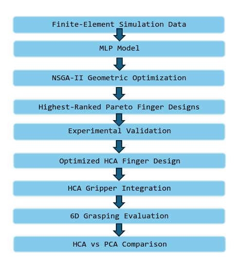

# HCA Mechanism for Cluttered Waste Sorting

A computational and experimental framework for the **Hybrid Compliance Activation (HCA) gripper** for robotic manipulation in cluttered waste-sorting environments.

The framework covers three major stages: **MLP-assisted geometric optimization of the adaptive Fin-Ray finger, experimental validation of the optimized finger designs, and 6D robotic grasping evaluation using the HCA and PCA grippers**.

---

## 1. NSGA-II and MLP Integration

[`NSGA-II-and-MLP-Integration`](https://anonymous.4open.science/r/NSGA-II-and-MLP-Integration-B068)

Computational framework for **geometric optimization of the adaptive Fin-Ray finger**.

Finite-element simulation data are used to train a **Multi-Layer Perceptron (MLP)** model that predicts the mechanical response of candidate finger geometries under different contact conditions. The trained MLP is subsequently integrated with an **NSGA-II-based multi-objective optimization framework** to efficiently explore the design space without requiring repeated finite-element simulations for every newly generated candidate.

The final constrained Pareto front is evaluated using a normalized **minimum-distance-to-utopia** approach to identify the five highest-ranked finger designs for subsequent validation.

---

## 2. Experimental Validation Setup for Optimal Design Testing

[`Experimental-Validation-Setup-for-Optimal-design-testing`](https://anonymous.4open.science/r/Experimental_Validation_Setup_for_Optimal_design_testing-7CFE)

Experimental framework for **validating the deformation behaviour of the optimized Fin-Ray finger designs**.

The validation system combines Dynamixel-based finger actuation, a deformable Ecoflex 00-50 half-proxy with a rigid core, and two approximately orthogonal camera views. A calibrated red-marker tracking method is used to quantify the three-dimensional fingertip displacement and obtain the corresponding **Δx, Δy, and Δz** components for comparison with the computational predictions.

The implementation provides the camera acquisition, actuator control, calibration, marker detection, and fingertip-displacement calculation procedures required for experimental evaluation.

---

## 3. 6D Grasping using HCA and PCA Grippers

[`6D-Grasping-using-HCA-and-PCA-grippers`](https://anonymous.4open.science/r/6D-Grasping-using-HCA-and-PCA-grippers-8E5B)

Two **6D robotic grasping pipelines for cluttered waste sorting**, implemented using the **Hybrid Compliance Activation (HCA) gripper** and the **Passive Compliance Activation (PCA) gripper**.

The pipelines integrate robotic perception, 6D grasp generation, motion planning, gripper actuation, and pick-and-place execution to evaluate grasping performance in cluttered environments containing heterogeneous inorganic waste objects.

A common experimental framework is maintained across the HCA and PCA implementations, enabling consistent comparative evaluation of the two gripper mechanisms.

---

## Accessing the Complete Project

For double-anonymous review, the three project components are provided as separately anonymized repositories and can be accessed through the links above.

Each component can be downloaded or cloned independently and includes a dedicated `README.md` with installation, configuration, and execution instructions.

> **Note:** The original project uses Git submodules. As submodule contents are not included directly by Anonymous GitHub, the anonymized links above should be used to access each component.

---

## Overall Workflow

  

